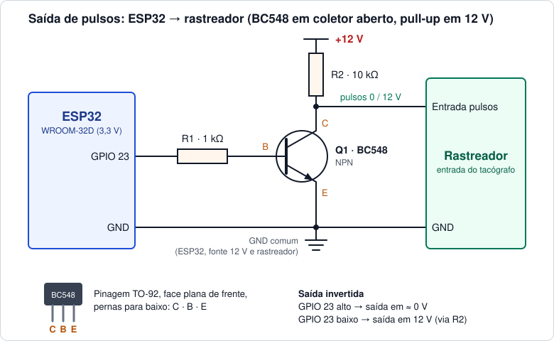
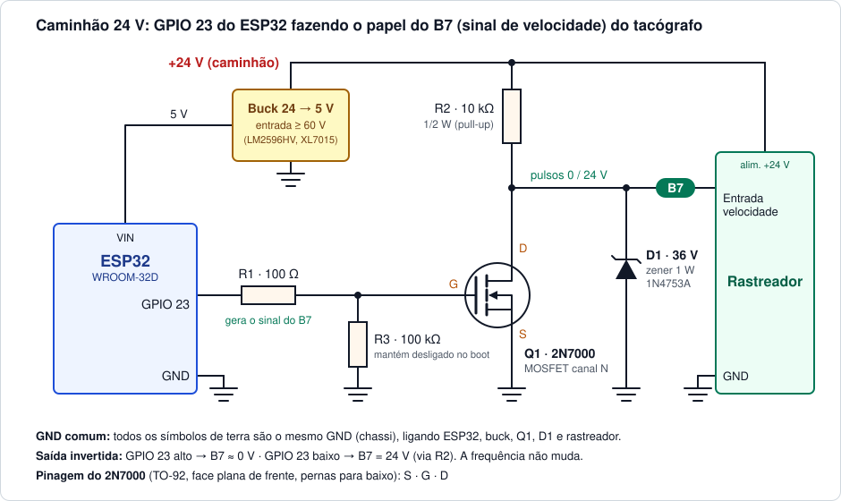

# POC11 - Simulador de tacógrafo (ESP32)

Simula o sensor de velocidade de um tacógrafo com um ESP32-WROOM-32D. O GPIO 23 gera uma onda quadrada (50% de duty) cuja frequência é proporcional à velocidade, e um BC548 em coletor aberto eleva esse sinal para 12 V, para ligar na entrada de pulsos de um rastreador.

A velocidade é controlada por comandos na serial: valor fixo ou uma rampa que sobe e desce sozinha.

## Circuito



| Componente | Ligação |
| --- | --- |
| R1 · 1 kΩ | entre o GPIO 23 e a **base** do BC548 |
| R2 · 10 kΩ | entre o +12 V e o **coletor** do BC548 (pull-up) |
| Coletor (C) | entrada de pulsos do rastreador |
| Emissor (E) | GND do ESP32 |

O pino que vai ao rastreador é o **coletor**, e o que vai ao GND é o **emissor**. No BC548 (TO-92), olhando para a face plana com as pernas para baixo, a ordem é C · B · E. Algumas variantes trocam a ordem, então vale conferir no datasheet do seu lote.

Pontos de atenção:

- **GND comum.** O GND do ESP32, o da fonte de 12 V e o do rastreador precisam estar ligados juntos, senão o rastreador não enxerga o sinal.
- **Sinal invertido.** GPIO 23 em nível alto satura o transistor e a saída vai a ≈ 0 V; em nível baixo, R2 puxa a saída para 12 V. A frequência não muda, mas com o simulador parado (`stop`) a linha fica em **12 V**, e não em 0 V.
- **12 V nunca chegam ao ESP32.** O GPIO só enxerga a base através de R1 (≈ 2,6 mA).

## Instalação no caminhão (24 V, saída B7)

No caminhão, o GPIO 23 faz o papel do **B7** do tacógrafo (saída do sinal de velocidade), que é o pino que alimenta a entrada de velocidade do rastreador.



Num sistema de 24 V a linha fica em 28 a 29 V com o alternador carregando, pode chegar a uns 48 V numa partida auxiliar, e tem picos perto de 58 V (load dump). Por isso o BC548 (30 V) não serve aqui e o circuito muda:

| Componente | Ligação |
| --- | --- |
| Q1 · 2N7000 (60 V) | **dreno (D)** na saída B7, **source (S)** no GND, **gate (G)** no R1 |
| R1 · 100 Ω | entre o GPIO 23 e o gate |
| R3 · 100 kΩ | entre o gate e o GND, para manter a saída definida durante o boot do ESP32 |
| R2 · 10 kΩ 1/2 W | entre o +24 V e o dreno (pull-up); 1/2 W porque dissipa ≈ 0,23 W a 48 V |
| D1 · zener 36 V 1 W (1N4753A) | catodo no dreno, anodo no GND; grampeia os picos abaixo dos 60 V do 2N7000 |
| Buck 24 → 5 V | alimenta o VIN do ESP32; precisa aceitar **60 V ou mais na entrada** (LM2596HV, XL7015) |

- Pinagem do 2N7000 (TO-92, face plana de frente, pernas para baixo): **S · G · D**, diferente do C · B · E do BC548.
- O zener aguenta o pico porque o pull-up de 10 kΩ limita a corrente que chega a ele: mesmo a 58 V, passam só uns 2 mA.
- Se a entrada do rastreador já tem pull-up interno, R2 pode ser dispensado. D1 continua valendo.
- O 2N7000 não é um MOSFET de nível lógico (o Vgs(th) pode chegar a 3 V), mas com a carga de ≈ 2,4 mA ele conduz o suficiente com os 3,3 V do GPIO. Se quiser margem, o BSS138 (SMD) é o equivalente de nível lógico.
- A saída continua invertida e o GND continua comum (chassi), como na versão de bancada.

## Como funciona

```
f [Hz] = velocidade [km/h] × K [pulsos/km] / 3600
```

`K` é a constante do tacógrafo, em pulsos por km (padrão: 4000). Exemplos com K = 4000:

| Velocidade | Frequência |
| --- | --- |
| 10 km/h | 11,1 Hz |
| 80 km/h | 88,9 Hz |
| 120 km/h | 133,3 Hz |

Os pulsos são gerados por um timer de hardware (resolução de 1 µs), e cada pulso é contado para formar o hodômetro (`pulsos / K` = km).

Limites:

| Parâmetro | Valor |
| --- | --- |
| Velocidade | 0 a 300 km/h (abaixo de 0,05 km/h é considerado parado) |
| K | 100 a 100000 pulsos/km |
| Frequência máxima | 10 kHz (com K alto, a velocidade máxima é reduzida para respeitar esse limite) |

## Comandos

Serial a 115200 baud, um comando por linha (terminado por Enter).

| Comando | O que faz | Exemplo |
| --- | --- | --- |
| `v <kmh>` | Velocidade fixa (também `vel` ou `set`) | `v 80` |
| `sim [min max [taxa]]` | Sobe e desce entre `min` e `max` sem parar; `taxa` em km/h por segundo. Sem argumentos usa os últimos valores (padrão 0 a 120 a 5 km/h/s) | `sim 0 120 5` |
| `stop` | Para a simulação, 0 km/h (também `p` ou `parar`) | `stop` |
| `k <pulsos/km>` | Define a constante K; sem argumento, mostra o valor atual | `k 4000` |
| `log [on\|off]` | Liga/desliga o log a cada 1 s; sem argumento, alterna | `log off` |
| `status` | Mostra o estado atual (também `s`) | `status` |
| `zero` | Zera o hodômetro | `zero` |
| `help` | Lista os comandos (também `h` ou `?`) | `help` |

Linha de status:

```
[FIXO] 80.0 km/h | 88.9 Hz | K=4000 | 1234 pulsos | 0.309 km
```

O modo é `PARADO`, `FIXO` ou `SIMULANDO`.

## Compilar e gravar

Projeto [PlatformIO](https://platformio.org/) (placa `esp32dev`, framework Arduino):

```sh
pio run -t upload
pio device monitor
```

A porta de upload está fixa em `/dev/tty.usbserial-0001` no [platformio.ini](platformio.ini); ajuste para a sua.

## Estrutura

- [src/main.cpp](src/main.cpp): gerador de pulsos, simulação e comandos da serial
- [docs/circuito.svg](docs/circuito.svg): diagrama do circuito de bancada (12 V, BC548)
- [docs/circuito-b7-24v.svg](docs/circuito-b7-24v.svg): diagrama da instalação no caminhão (24 V, saída B7)
